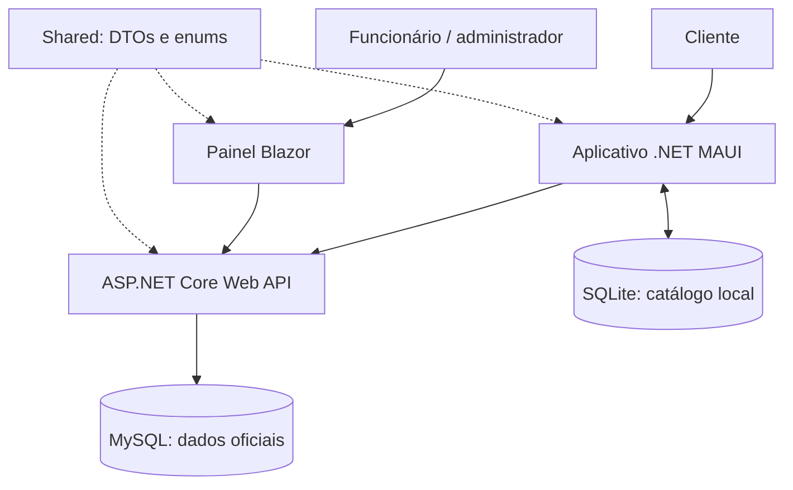
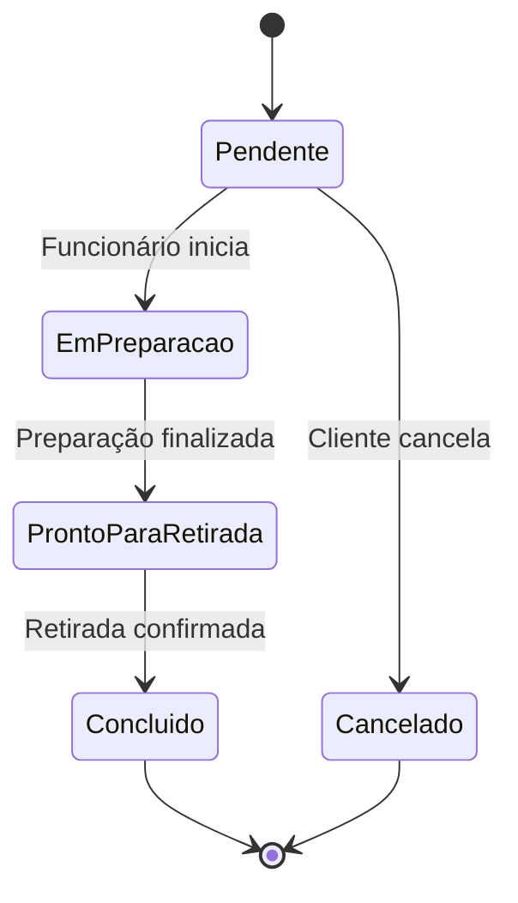

<div align="center">

# 🛍️ MinhaLoja

### Do catálogo ao pedido. Do pedido à gestão.

Uma plataforma em C# que conecta clientes, funcionários e estoque em uma única solução.


[Visão geral](#visão-geral) · [Funcionalidades](#funcionalidades) · [Arquitetura](#arquitetura) · [Como executar](#como-executar) · [Validação](#validação-e-entrega)

</div>

---

## Visão geral

O **MinhaLoja** é um sistema acadêmico de vendas e gestão de produtos, desenvolvido com foco em uma loja de produtos de limpeza. A solução reúne um aplicativo para clientes, uma API responsável pelas regras de negócio e um painel Web para a operação da loja.

No aplicativo, o cliente consulta o catálogo, cria sua conta, monta o carrinho, realiza pedidos e acompanha suas compras. No painel, funcionários e administradores cadastram produtos, organizam categorias, repõem o estoque e atualizam as etapas de preparação dos pedidos.

O servidor mantém os dados oficiais no **MySQL**. O aplicativo armazena uma cópia do catálogo em **SQLite**, permitindo consultá-lo mesmo quando a API estiver indisponível.

### Contexto acadêmico

A proposta integra três partes exigidas na atividade:

| Parte | Tecnologia | Responsabilidade |
|---|---|---|
| Aplicativo do cliente | .NET MAUI + SQLite | Consultar produtos, criar e acompanhar pedidos |
| API | ASP.NET Core + MySQL | Autenticar usuários, validar operações e persistir os dados |
| Painel de funcionários | Blazor | Gerenciar produtos, categorias, estoque e pedidos |

Uma biblioteca **Shared** centraliza os contratos de comunicação utilizados pelos três projetos.

## Funcionalidades

### 📱 Experiência do cliente

- Cadastro de conta com validação dos dados e confirmação de senha.
- Login e armazenamento da sessão com `SecureStorage`.
- Catálogo com nome, descrição, preço e quantidade disponível.
- Consulta do catálogo local quando a API estiver indisponível.
- Aviso da data da cópia local e da possibilidade de dados desatualizados.
- Carrinho com inclusão, remoção, alteração de quantidades e total estimado.
- Envio de pedidos com observação opcional.
- Listagem paginada dos próprios pedidos, detalhes dos itens e acompanhamento do status.
- Cancelamento de pedidos pendentes, com devolução do estoque pela API.

### 🖥️ Operação da loja

- Login no painel com acesso por perfil.
- Cadastro e edição de produtos.
- Reposição de estoque por quantidade recebida.
- Cadastro, edição, ativação e inativação de categorias.
- Restrição de nomes duplicados de categorias no banco.
- Listagem de pedidos com filtro de status e paginação.
- Consulta dos detalhes: cliente, itens, quantidades, preços, observação e total.
- Avanço do status conforme o fluxo permitido.

### ⚙️ Regras centralizadas na API

- Validação das requisições com DTOs e Data Annotations.
- Senhas armazenadas por meio do `PasswordHasher` do ASP.NET Core Identity.
- Autenticação JWT com validação de assinatura, emissor, público e validade.
- Autorização por perfis `Cliente`, `Funcionario` e `Administrador`.
- Cadastro público cria exclusivamente contas de cliente.
- Consultas de pedidos do cliente filtradas pela identidade autenticada.
- Cálculo dos valores da compra com os preços oficiais do banco.
- Preservação do nome e do preço unitário de cada item no momento da compra.
- Transações e bloqueios de registros nas operações de compra, cancelamento e reposição.

## Arquitetura



O aplicativo e o painel acessam os dados pela API. A autorização e as regras da compra são verificadas no servidor, independentemente dos controles apresentados nas telas.

### Organização dos projetos

| Projeto | Conteúdo principal |
|---|---|
| `MinhaLoja.Api` | Controllers, entidades, DbContext, migrations, autenticação e serviço de pedidos |
| `MinhaLoja.Shared` | DTOs de autenticação, produtos, categorias e pedidos; enum de status |
| `MinhaLoja.Web` | Componentes Razor, páginas administrativas e serviços HTTP |
| `MinhaLoja.Mobile` | Páginas MAUI, serviços HTTP, sessão, carrinho e persistência SQLite |

O aplicativo utiliza páginas XAML/C# e serviços injetados. Esta versão **não adota MVVM de forma integral**; a evolução para ViewModels fica como possibilidade de refatoração futura.

## Ciclo de vida do pedido



| Regra | Comportamento |
|---|---|
| Criação | O servidor valida cliente, produtos, categoria, quantidades e estoque |
| Estoque insuficiente | O pedido é rejeitado; os itens não são parcialmente confirmados |
| Preço | O valor oficial é obtido no servidor e registrado no item do pedido |
| Atualização de status | Só permite a próxima etapa; verifica o status informado pelo operador |
| Cancelamento | Permitido ao titular enquanto o pedido estiver pendente |
| Pedido cancelado | Continua no histórico; o estoque é devolvido uma única vez |
| Categoria inativa | Seus produtos deixam de aparecer no catálogo online |
| Reposição | Soma unidades ao saldo atual, sem usar o saldo antigo exibido na tela |

### O que funciona sem conexão?

| Operação | Disponível sem a API? |
|---|---|
| Consultar catálogo já armazenado | Sim |
| Montar carrinho com os produtos da cópia local | Sim, com dados potencialmente desatualizados |
| Criar conta ou validar login | Não |
| Finalizar compra | Não |
| Consultar ou cancelar pedidos | Não |

O SQLite é um **cache de consulta**, não uma fila de pedidos offline. O carrinho desta versão fica em memória. O total exibido antes da compra é estimado; a API confirma preço e disponibilidade ao finalizar.

## Tecnologias

| Camada | Tecnologias utilizadas |
|---|---|
| Linguagem e plataforma | C# e .NET 10 |
| Backend | ASP.NET Core Web API, controllers e OpenAPI |
| Persistência no servidor | Entity Framework Core, `MySql.EntityFrameworkCore`, MySQL 8.0 e migrations |
| Autenticação | JWT Bearer, PasswordHasher e autorização por perfil |
| Web | Blazor com interatividade no servidor, autenticação por cookie e Bootstrap |
| Aplicativo | .NET MAUI, XAML, páginas em C# e injeção de dependências |
| Persistência local | `sqlite-net-pcl`, SQLite e SecureStorage para a sessão |
| Ferramentas | Visual Studio, PowerShell, MySQL Workbench, Git e GitHub |

## Como executar

### 1. Pré-requisitos

- .NET 10 SDK; o ambiente de desenvolvimento utilizado possui SDK `10.0.402`.
- Visual Studio com suporte a .NET MAUI para executar o aplicativo.
- MySQL Server 8.0 em execução.
- Git e acesso aos pacotes NuGet.
- Para Android: SDK, emulador ou dispositivo configurado no ambiente de desenvolvimento.

### 2. Obter o código

```powershell
git clone https://github.com/rafaelgitwork/MinhaLoja.git
Set-Location MinhaLoja
dotnet tool restore
```

O manifesto de ferramentas está em `dotnet-tools.json`, na raiz da solução.

### 3. Configurar a API

Configure as credenciais localmente com **User Secrets**. Substitua os valores de exemplo antes de executar:

```powershell
dotnet user-secrets set "ConnectionStrings:DefaultConnection" "Server=127.0.0.1;Port=3306;Database=minhaloja_dev;Uid=SEU_USUARIO;Pwd=SUA_SENHA;" --project MinhaLoja.Api

dotnet user-secrets set "Jwt:Issuer" "MinhaLoja.Api" --project MinhaLoja.Api
dotnet user-secrets set "Jwt:Audience" "MinhaLoja.Clientes" --project MinhaLoja.Api
dotnet user-secrets set "Jwt:ExpirationMinutes" "60" --project MinhaLoja.Api
```

Gere uma chave aleatória para assinar os tokens:

```powershell
$bytesJwt = New-Object byte[] 32
$geradorJwt = [System.Security.Cryptography.RandomNumberGenerator]::Create()
$geradorJwt.GetBytes($bytesJwt)
$geradorJwt.Dispose()
$chaveJwt = [Convert]::ToBase64String($bytesJwt)

dotnet user-secrets set "Jwt:Key" "$chaveJwt" --project MinhaLoja.Api
Remove-Variable chaveJwt, bytesJwt, geradorJwt
```

Não publique a chave JWT nem a senha do banco no repositório. User Secrets é uma configuração de desenvolvimento, não um cofre de produção.

### 4. Aplicar o banco de dados

Com o MySQL em execução e um usuário com as permissões necessárias:

```powershell
$env:ASPNETCORE_ENVIRONMENT = "Development"
$env:DOTNET_ENVIRONMENT = "Development"

dotnet ef database update --project MinhaLoja.Api --startup-project MinhaLoja.Api
```

Em uma instalação existente, preserve o histórico de migrations. A migration vazia `NomeUnicoCategoria` faz parte do histórico; a migration posterior `CriaIndiceUnicoNomeCategoria` cria o índice efetivo.

### 5. Iniciar a API

```powershell
dotnet run --project MinhaLoja.Api --launch-profile http
```

Endereço: **http://localhost:5271**  
Documento OpenAPI em desenvolvimento: **http://localhost:5271/openapi/v1.json**

### 6. Iniciar a Web

Confira `ApiSettings:BaseUrl` na configuração da Web:

```json
{
  "ApiSettings": {
    "BaseUrl": "http://localhost:5271/"
  }
}
```

Em outro terminal:

```powershell
dotnet run --project MinhaLoja.Web --launch-profile http
```

Acesse **http://localhost:5203**.

### 7. Preparar uma conta administrativa local

O cadastro público cria apenas clientes. A versão atual não inclui uma tela de gestão de funcionários nem um administrador criado automaticamente.

Para a demonstração local, cadastre uma conta pelo aplicativo e altere **somente essa conta** no MySQL Workbench:

```sql
UPDATE minhaloja_dev.Usuarios
SET Perfil = 'Administrador'
WHERE EmailNormalizado = 'SEU_EMAIL_ADMIN@EXEMPLO.COM';
```

Substitua o endereço pelo e-mail da conta criada, em letras maiúsculas. Depois entre novamente no painel para obter uma sessão com o perfil atualizado. Essa preparação é destinada ao ambiente local controlado.

### 8. Executar o MAUI no Windows

```powershell
dotnet build MinhaLoja.Mobile/MinhaLoja.Mobile.csproj -f net10.0-windows10.0.19041.0
```

No Visual Studio, abra `MinhaLoja.sln`, selecione **MinhaLoja.Mobile** como projeto de inicialização, escolha **Windows Machine** e execute com **F5**.

### 9. Preparar a execução no Android

```powershell
dotnet build MinhaLoja.Mobile/MinhaLoja.Mobile.csproj -f net10.0-android
```

Selecione um emulador Android no Visual Studio e execute o aplicativo. A validação integrada dessa plataforma ainda faz parte da conclusão da entrega.

| Ambiente do aplicativo | Endereço da API |
|---|---|
| Windows no mesmo computador | `http://localhost:5271/` |
| Emulador Android | `http://10.0.2.2:5271/` |
| Celular físico | Requer configurar o endereço acessível do computador e a rede local |

Os endereços são definidos em `MinhaLoja.Mobile/Configuracao/ApiConfiguracao.cs`. O HTTP local no Android está liberado apenas na configuração Debug. Um ambiente publicado precisa de HTTPS e configuração própria de acesso.

## Endpoints principais

As rotas abaixo são relativas ao endereço da API.

| Método | Rota | Finalidade | Acesso |
|---|---|---|---|
| POST | `/api/auth/cadastro` | Criar conta de cliente | Público |
| POST | `/api/auth/login` | Autenticar | Público |
| GET | `/api/auth/me` | Consultar usuário atual | Autenticado |
| GET | `/api/produtos` | Listar catálogo ativo | Público |
| GET | `/api/produtos/{id}` | Consultar produto | Público |
| POST | `/api/produtos` | Cadastrar produto | Funcionário/administrador |
| PUT | `/api/produtos/{id}` | Editar produto | Funcionário/administrador |
| POST | `/api/produtos/{id}/estoque/reposicoes` | Adicionar estoque | Funcionário/administrador |
| GET | `/api/categorias` | Listar categorias ativas | Público |
| GET | `/api/categorias/{id}` | Consultar categoria | Público |
| GET | `/api/categorias/gestao` | Listar ativas e inativas | Funcionário/administrador |
| POST | `/api/categorias` | Cadastrar categoria | Funcionário/administrador |
| PUT | `/api/categorias/{id}` | Editar nome e situação | Funcionário/administrador |
| POST | `/api/pedidos` | Criar pedido | Cliente |
| GET | `/api/pedidos` | Listar próprios pedidos | Cliente |
| GET | `/api/pedidos/{id}` | Consultar próprio pedido | Cliente |
| POST | `/api/pedidos/{id}/cancelar` | Cancelar pedido pendente | Cliente titular |
| GET | `/api/gestao/pedidos` | Listar e filtrar pedidos | Funcionário/administrador |
| GET | `/api/gestao/pedidos/{id}` | Consultar detalhes administrativos | Funcionário/administrador |
| PUT | `/api/gestao/pedidos/{id}/status` | Avançar etapa | Funcionário/administrador |

Exemplo de criação de pedido:

```json
{
  "observacao": "Retirada no período da tarde.",
  "itens": [
    {
      "produtoId": 1,
      "quantidade": 2
    }
  ]
}
```

O cliente não informa o preço nem escolhe o usuário proprietário do pedido. A API obtém esses dados do banco e da autenticação.

## Validação e entrega

### Cenários exercitados durante o desenvolvimento

- Login válido, senha incorreta e acesso sem token.
- Restrição de ações administrativas para clientes.
- Isolamento dos pedidos entre contas de clientes.
- Criação de pedido com cálculo do total e desconto de estoque.
- Rejeição de estoque insuficiente e de pedido com item inválido, preservando o saldo observado.
- Duas solicitações pela última unidade, com uma compra aceita e outra rejeitada no teste executado.
- Cancelamento pendente, devolução do estoque e bloqueio de novo cancelamento.
- Transições de status válidas e rejeição de saltos de etapa.
- Cadastro, edição e disponibilidade de categorias; índice único confirmado no MySQL.
- Reposição pelo painel e atualização do catálogo.
- Persistência do catálogo após fechar o aplicativo e reabri-lo sem a API.

Esses registros correspondem a verificações manuais de desenvolvimento. Não equivalem a uma suíte automatizada nem demonstram todos os cenários possíveis de concorrência.

### Pendências para fechar a apresentação

- [ ] Concluir e validar a limpeza do carrinho e da observação na saída da conta.
- [ ] Concluir a recuperação de operações cujo resultado não foi confirmado por falha de conexão.
- [ ] Testar compra simultânea à reposição de estoque.
- [ ] Validar o fluxo completo em Android.
- [ ] Finalizar identidade visual, responsividade e usabilidade.
- [ ] Implementar e executar testes automatizados das regras e dos endpoints.
- [ ] Adicionar capturas reais da Web e do aplicativo a esta documentação.

Não há integração de pagamento, cálculo de frete ou envio automático de pedidos offline nesta versão. O fluxo operacional atual é de preparação e retirada na loja.

## Decisões de implementação

- **Contrato compartilhado:** DTOs reduzem divergências entre API, Web e aplicativo.
- **Servidor como autoridade:** preços, estoque, titularidade e transições são validados na API.
- **Histórico preservado:** cancelar não exclui o pedido, e editar o produto não muda os valores já registrados nos itens.
- **Cache identificado:** o aplicativo informa quando está usando uma cópia local do catálogo.
- **Reposição separada da edição:** alterar nome ou preço não sobrescreve a quantidade em estoque.
- **Sessões por plataforma:** JWT na comunicação com a API, cookie protegido no painel e SecureStorage no aplicativo.
- **Evolução incremental:** implementação e verificação de fluxos antes do acabamento visual.

[](https://github.com/rafaelgitwork)
